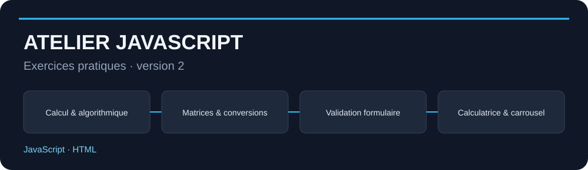

# ATELIER JAVASCRIPT

**Exercices pratiques · version 2**

JavaScript · HTML

## Overview

Travaux pratiques consacrés aux fondamentaux de JavaScript, à la logique algorithmique et aux interactions web.

## Exercices
| Fichier | Sujet |
| --- | --- |
| `decimal_to_binary.js` | Conversion décimal-binaire |
| `pgcd.js` | Plus grand commun diviseur |
| `matrices.js` | Manipulation de matrices |
| `somme_chiffres.js` | Somme des chiffres |
| `table_multiplication.js` | Tables de multiplication |
| `form_validation.js` | Validation de formulaire |
| `calculatrice.html` | Interface de calculatrice |
| `carrousel.html` | Carrousel d'images |

## Utilisation
Les exercices se trouvent dans [Atelier 1 Javascript](Atelier%201%20%20Javascript/). Ouvrir les pages HTML dans un navigateur et consulter les scripts JavaScript individuellement.

Ce dépôt présente des exercices pédagogiques, plutôt qu'une application unique.
